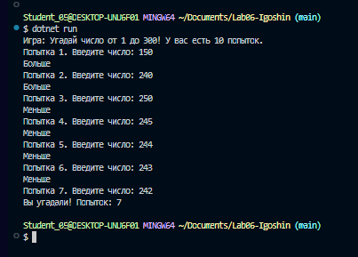
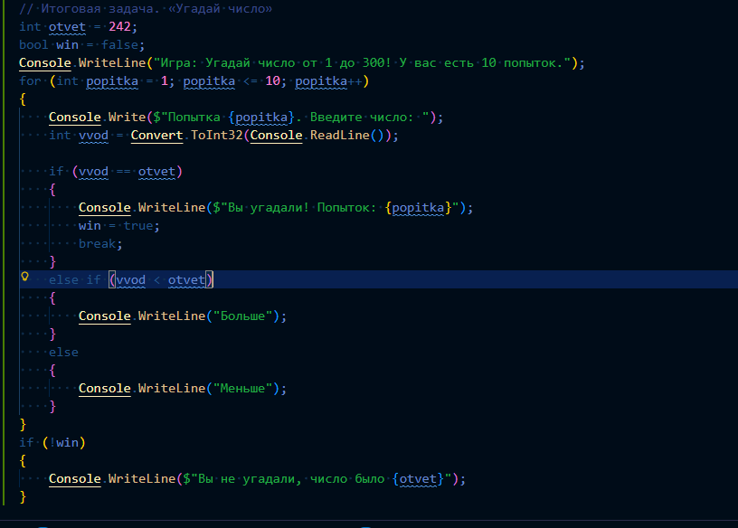
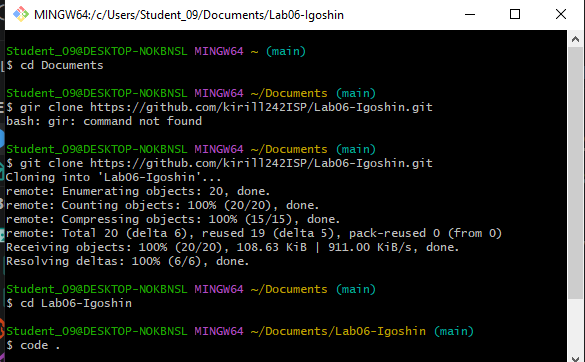

# Практическая работа №6
**ФИО: Игошин Кирилл Вячеславович**  
Группа: ИСП-242  
Дата: 24.10.2026
## Что изучено

| Конструкция | Когда нужна |
| :--- | :--- |
| `for` | известно, сколько раз повторять |
| `while` | повторять, пока верно условие |
| `do while` | нужно выполнить хотя бы один раз |
| `break` | выйти из цикла досрочно |
| `continue` | пропустить текущий шаг |
| `if`, `else`, `switch` | использовать внутри циклов для ветвления |
| ввод/вывод | использовать внутри циклов для общения с пользователем |

# Скриншоты 

